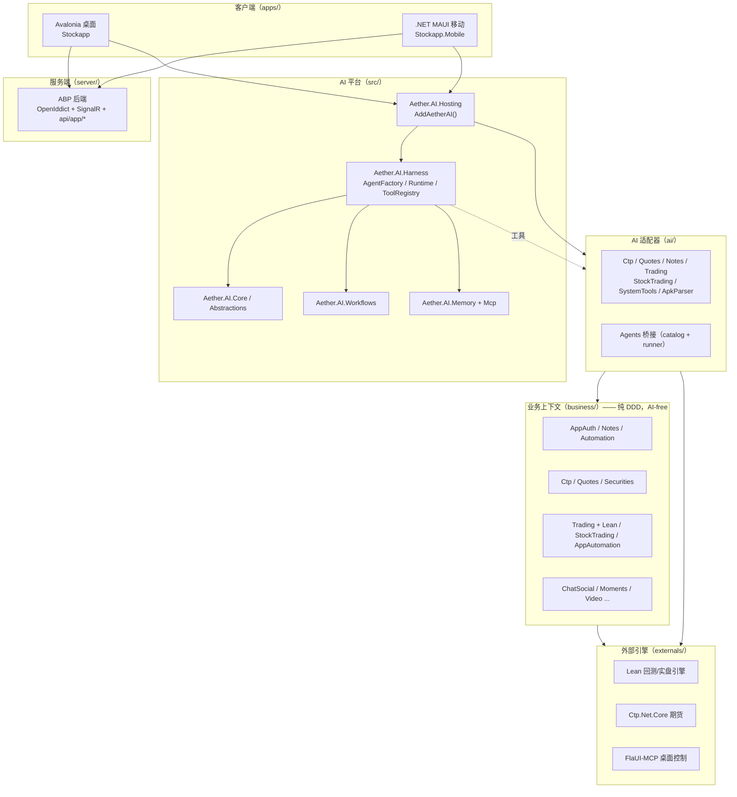

# Aether

> 基于 **Microsoft Agent Framework** 的多租户 AI Agent 平台 —— 桌面 / 移动 / 服务端一体，DDD 分层，引擎可插拔。

Aether 把"AI Agent 能力"沉淀成一个独立平台（`src/`），在此之上承载纯 DDD 业务上下文（`business/`），再通过薄适配器（`ai/`）把业务工具暴露给 Agent。客户端（Avalonia 桌面 / .NET MAUI 移动）与 ABP 服务端（`server/`）同仓一体，业务层始终 AI-free。

---

## 架构



**分层铁律**：`business/` 永不引用 `Aether.AI.*`；Domain 零依赖；依赖图是 DAG（`AppAuth.Domain` 是源，`Trading.Runtime.Lean` 是汇）。AI 适配器只引业务 Application 层（个别编译验证例外）。换运行时（如 Lean→其他）是 DI-only 改动，业务层与 UI 不动。

---

## 核心能力

**Agent 生态**
- **自定义 Agent**：每 Agent 独立 ModelId / 记忆策略（Full / SlidingWindow / Off）/ 采样参数 / 长期记忆
- **多 Agent 工作流**：MAF Handoff 工作流，复用同一流式管线
- **规则大脑 Agent**：LLM 换成确定性规则，零 token 决策；另有 `run_rule` 工具形态对 LLM 隐藏原始结果、省 token
- **代码规则 / 策略脚本**：C# / YAML 源码笔记 → Roslyn 动态编译，策略自进化闭环

**扩展机制**（专家编辑器统一勾选）
- **Tools**：进程内强类型工具，三级审批（Safe / Confirm / Dangerous）
- **MCP**：跨进程 / 跨语言外部工具，stdio / HTTP server，与 Claude Code / Cursor 配置互拷
- **Skills**：prompt + Python 脚本能力，按需 `load_skill` 进上下文
- **Knowledge Objects**：微型知识图谱，typed graph links，按需 `read`，改一处全流程生效

**交互面**
- 全流式输出：推理 / 工具调用 / 审批 / 计划 / `ask_user` 多问表单
- Plan / Execute 双模式；工具审批协作重入循环
- ChatGPT 式多会话持久化（SQLite，含工具调用与推理的完整转录）

**领域引擎**
- **期货**：CTP 行情 + 交易（`Ctp.Net.Core` 原生封装）
- **回测 / 实盘**：QuantConnect Lean 引擎，策略动态加载，P1 信号探针 / P2 真实委托
- **A股 GUI 自动化**：同花顺客户端 FlaUI 驱动下单，或经 MCP 桌面控制固定过程
- **桌面控制**：FlaUI-MCP out-of-process server，固定过程 + LLM 直连双路径

---

## 解决方案结构

单解决方案 `Aether.AI.Platform.slnx`（`.slnx`，非 `.sln`），.NET 10，共 101 个项目。

| 目录 | 职责 |
|------|------|
| `src/` | **Aether.AI 平台**（独立可用）：Abstractions / Core / Harness / Workflows / Memory / Mcp / Hosting |
| `business/` | **纯 DDD 业务上下文**：AppAuth / Notes / Automation / Ctp / Quotes / Securities / Trading(+Runtime) / StockTrading / AppAutomation / ChatSocial / Moments … |
| `ai/` | **业务 AI 适配器**：7 工具适配器 + 1 Agent 桥接 |
| `apps/` | 客户端：Avalonia 桌面（`Desktop/`）+ MAUI 移动（`Mobile/`）+ 租户 host |
| `server/` | **ABP 服务端**（`Aether.Server.*`）：HttpApi.Host（:44319）+ Blazor 管理后台（:44337）+ DbMigrator |
| `externals/` | 第三方引擎：Lean / Ctp.Net.Core / FlaUI-MCP（**Lean 与 FlaUI-MCP 为 git submodule**） |
| `mcp/` | 自写 MCP server 源码（范例） |
| `tests/` | 全部测试项目 |

### 租户

平台支持多租户，仓库内置 **Stockapp** 租户：

| 租户 | 桌面 | 移动 | 领域 |
|------|------|------|------|
| **Stockapp** | CTP 期货 / 股票 / 回测+实盘 | 社交 + Quotes Agent 工具 | 期货 / A股 / 量化 |

---

## 构建与运行

```bash
# git submodules（Lean 量化引擎 / FlaUI-MCP 桌面控制，首次构建前 init）
git submodule update --init externals/Lean externals/FlaUI-MCP

dotnet build Aether.AI.Platform.slnx     # 构建全部
dotnet test  Aether.AI.Platform.slnx     # 运行所有测试

# 桌面应用（Avalonia）
dotnet run --project apps/Stockapp/Acme.Stockapp.Desktop

# ABP 服务端（本地直接可运行：dev 配置 + openiddict.pfx 已就位）
dotnet run --project server/Aether.Server.HttpApi.Host   # :44319 API + OAuth2 + SignalR
dotnet run --project server/Aether.Server.Blazor         # :44337 管理后台
```

首次构建较慢（Lean 源码编译）。Lean 传递依赖的 NU1902/3/4 漏洞告警为预期（advisory only）。

> macOS / Linux 上 `StockTrading.Infrastructure`（net10.0-windows + FlaUI/WPF）自动按 TFM 条件跳过；CTP 期货 / A股 GUI 自动化为 Windows 专属，其它平台惰性占位不崩。

---

## 技术栈

- **.NET 10** · **Microsoft Agent Framework**（`Microsoft.Agents.AI`）
- **Avalonia 12**（桌面）· **.NET MAUI**（移动）· **ABP 10.4.1**（服务端）
- **QuantConnect Lean**（量化引擎）· **Microsoft.Data.Sqlite**（客户端持久化）
- **SQL Server + OpenIddict + SignalR**（服务端）· **Serilog / Autofac**
- **Roslyn**（策略 / 规则动态编译）· **AvaloniaEdit**（代码编辑器）

---

## 文档

详细架构、约定与踩坑记录见 [CLAUDE.md](CLAUDE.md)（项目级开发指南，含 DDD 分层规则、AI 适配器约定、各上下文设计、构建陷阱等）。
