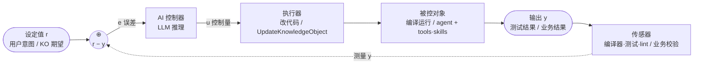

# AI 编程扩展：控制工程思维路线图

> 在 Aether 知识对象闭环架构上扩展 AI 编程能力时，用控制工程思维保证可靠收敛。
> 核心铁律：**传感器质量 > 控制器智能，前馈 > 反馈，小步长 > 大跨越，可观测 > 可控**。

## 背景

Aether 的知识对象闭环（创建→读取→执行→调整）是自适应反馈控制系统。扩展到 AI 编程场景时，AI 编程有幸站在编译器/测试这个"完美传感器"之上——但要保持这个优势，必须显式建设传感器、前馈、稳定性判据，而不是指望 LLM 控制器自己兜底。

控制工程从不指望靠控制器智能补传感器缺陷。AI 编程扩展的投入优先级应是：传感器 > 前馈 > 稳定性 > 控制器能力。

## 控制闭环结构



- **前向通道**：r → 误差 → AI 控制器 → 执行器 → 被控对象 → 输出
- **反馈通道**：输出 → 传感器 → 误差端（负反馈）
- **前馈**（图中未画）：类型系统 / lint / KO 硬约束，在执行前预拦截，不进反馈环
- **稳定性靠传感器信噪比**：AI 编程的传感器（编译器/测试）确定性精确，所以稳；业务闭环缺传感器，所以难稳

## 1. 传感器第一（信噪比决定上限）

**控制原理**：闭环稳定性上限由传感器信噪比决定，控制器再强也超不过这个上限。

**工程做法**：
- 每个编程场景必须接入确定性传感器：编译器、测试框架、类型检查、lint、静态分析。没有传感器的场景（如"凭感觉写"）不进闭环。
- 传感器输出要**结构化**，不是原始日志：错误能解析出位置（文件:行）、类型、信息、可修复建议。结构化误差信号让 AI 控制器精准定位——这是"信噪比"的工程体现。原始日志 = 高噪声。
- 传感器要**快**（低延迟反馈）。慢测试 = 低带宽闭环 = 收敛慢。优先跑单元测试（快）而非全量集成（慢）。
- 不要堆 LLM 能力来补传感器缺失。缺传感器就先造传感器，别让控制器智能补。

## 2. 前馈优先于反馈

**控制原理**：前馈（按已知扰动预补偿）+ 反馈（纠残余）最稳；前馈强 → 反馈负载小 → 闭环更稳。

**工程做法**：
- 选前馈强的技术栈：强类型（TS/Rust/Go）> 弱类型（JS/Python）> 无类型。类型系统是编译期前馈，挡一大类错，不进反馈环。
- lint/静态分析配置要严，作为前馈层。AI 改完先过 lint 再跑测试（两级传感器）。
- 把"项目约定"做成**可机校验的前馈规则**，而非只在知识对象里写"请遵守 XXX"这种软约束。能机校验 = 前馈；只能靠 AI 自觉 = 软约束，不可靠。
- 能前馈拦截的，绝不留给反馈。反馈是兜底，不是主力。

## 3. 小步快改（步长与稳定性）

**控制原理**：步长（增益）过大 → 过冲/震荡/发散；过小 → 收敛慢。

**工程做法**：
- 默认小步迭代：改一小块 → 立即跑传感器 → 再改。禁止"一次大改后跑"。
- 单次改动**限幅**：限制文件数/行数/范围。大改 = 大步长 = 易过冲（破坏原本对的、引新错）。
- 每次改动**可回退**（git 提交/快照）。震荡时 reset 到上一个稳定点。
- 小步长 + 高频反馈 = 高带宽稳定收敛。别追求"一次写对"（那是开环，不稳）。

## 4. 收敛判据与防发散（稳定性裕度）

**控制原理**：闭环可能极限环（震荡）/发散；需稳定性判据 + 抗积分饱和 + reset。

**工程做法**：
- **精确化"完成"定义**（设定值 r）：测试全过 + lint 清 + 行为符意图。模糊的"完成"= 设定值不清 = 闭环不知道往哪收敛。
- **防震荡判据**：连续 N 次迭代误差不降 → 停 + 回退 + 上报人（类似抗积分饱和——误差不降还持续加力只会震荡）。
- **防发散判据**：误差连续 M 次增大 → 停（系统在发散，继续是负作用）。
- **回退机制**：每步可 git reset；震荡/发散时自动回退到最近稳定点。
- AI 闭环没有解析极点判稳，但"误差趋势"是经验判据——误差不降或增大就该停，不是死磕。

## 5. 分层控制（规划 + 执行）

**控制原理**：外环规划（轨迹，慢）+ 内环跟踪（执行，快）；外环错内环再稳也白费。

**工程做法**：
- **外环（规划）**：架构/方案/任务分解——慢，低频，有自己的"传感器"（方案评审/人对齐）。
- **内环（执行）**：写具体代码 + 跑传感器——快，高频。
- **分层分别校验**：外环方案错（架构选错），内环测试再绿也是错。别只看内环测试，要校验外环方案。
- **外环出错回外环**，不是内环死磕。AI 编程常见问题：方案错了却在内环拼命改代码——内外环耦合错误。
- 分别设计两个环的传感器与判据：外环慢判据（人对齐），内环快判据（测试）。

## 6. 可观测性（状态可见才能可控）

**控制原理**：可观测性 = 能从输出推断内部状态；不可观测 = 不可控。

**工程做法**：
- **记录误差历史曲线**：每轮迭代的"错误数/失败数"序列。这是控制工程的阶跃响应曲线——看它判断收敛（单调降）/震荡（波动）/发散（上升）。
- **过程状态可见**：当前任务、改了什么、测试状态、在哪一步。不可见的 AI 编程 = 黑盒，出问题无法诊断。
- **用误差曲线调参**：震荡就降步长，发散就停，收敛慢就提带宽（更快传感器）。和调 PID 一样看响应曲线。
- 先让它可观测，再谈可控。日志/trace 不是装饰，是观测器。

## 7. 模型预测的边界（MPC 式预测只辅助）

**控制原理**：MPC 靠模型预测未来优化控制；模型不准时预测有害，需降步长 + 传感器纠错。

**工程做法**：
- AI 预测"改后效果"有用但不可靠（LLM 不是精确代码执行模型）。预测只用于"快"（先猜先改），**必须传感器兜底**。
- **禁止"自信大改"**：预测错 + 大步长 = 过冲。预测越不确定，步长越小。
- 预测模型不确定时，降增益、加反馈。别让 AI"我觉得这样改对"就大改——它觉得对 ≠ 传感器说对。

## 8. 知识对象在 AI 编程里的角色

- 编程任务的"知识对象"= 项目架构规则 / API 用法 / 代码风格 / 测试规范 / 领域模型。AI read 后按规格编程。
- 编程知识对象**天然有传感器**（编译/测试）——相比业务闭环的巨大优势，闭环天然稳。
- 把"怎么在这个项目编程"的隐性约定显式化成知识对象（`kind=规则`，body 写约定），AI read 遵守。改约定一处，所有任务下次 read 拿新版（复用）。
- 知识对象 = 控制器的可调参数（自适应），编程约定参数化后可演化。

## 9. 安全与权限（执行器限幅）

**控制原理**：执行器有饱和/限幅；破坏性动作需安全联锁。

**工程做法**：
- **approval 分层**（Safe/Confirm/Dangerous）：读/编译/测试 = Safe 自动跑；写文件/改配置 = Confirm；删文件/跑 shell/发网络 = Dangerous。
- **沙箱**：AI 编程在隔离环境跑（防误改系统）。
- 执行器限幅 + 安全联锁，防控制器误动作导致不可逆。

## 优先级排序

1. **传感器**（编译/测试/lint 接入 + 结构化输出）——没这个别谈 AI 编程
2. **前馈**（强类型/静态分析/可机校验规则）
3. **小步快改 + 步长限幅 + 回退**
4. **收敛判据 + 防震荡/发散**
5. **分层控制**（规划/执行分别校验）
6. **可观测性**（误差曲线/过程可见）
7. **预测兜底**（不依赖 LLM 预测）
8. **知识对象**存编程规格（自适应参数）
9. **安全审批**（执行器限幅）

## 落地实例：交易策略动态加载

交易策略场景是上述控制工程思维的完整落地——双传感器（编译器 + 回测）+ AI 自迭代闭环。

### 机制

策略源码存为笔记（`tags=strategy`、`syntax=csharp`、content 是 `IStrategy` 实现类 C# 源码）：

```
策略笔记（tags=strategy）
  → StrategyScriptingService.LoadAsync（启动 + NotesChanged 500ms 防抖）
  → Roslyn 动态编译（引用 AppDomain 已加载的 Acme.Trading.Domain.dll）
  → 反射找 IStrategy 实现 → StrategyRegistry.Register(笔记标题, factory)
  → StrategiesLoaded 事件 → TradingViewModel 刷新策略选择器（不重启即见）
  → 回测/实盘按 name 从 StrategyRegistry.Create 取
```

### AI 闭环

```
AI 调 CreateStrategy(name, source, parentId)
  → 创建策略笔记 + 即时编译验证（Compiled/CompileError 反馈，前馈传感器）
  → NotesChanged → ScriptingService 自动编译注册
  → AI 调 RunBacktest（回测，反馈传感器：收益/回撤/信号）
  → 结果差 → AI 改策略源码（NoteTool.UpdateNote）
  → NotesChanged → 重编译注册 → 再回测
```

### 控制工程对应

| 控制工程要素 | 交易策略闭环的落地 |
|---|---|
| 传感器（信噪比）| **编译器**（Roslyn，确定性编译错误）+ **回测**（Lean，确定性收益/回撤）——双传感器都精确 |
| 前馈 | 编译期拦截（源码写错即挡，不进回测）|
| 反馈 | 回测结果驱动 AI 调策略 |
| 控制器 | AI（读回测误差 → 改策略源码）|
| 控制量 | `NoteTool.UpdateNote` 改源码 |
| 自适应 | AI 迭代调策略源码（控制器参数自演化）|
| 小步快改 | 改源码 → 重编译 → 回测，单策略迭代 |
| 可观测 | `LoadErrors`（编译失败）+ 回测统计 + 日志 |

### 关键文件

- `business/Trading.Runtime/Acme.Trading.Scripting/` —— `StrategyScriptCompiler`（Roslyn 编译）、`StrategyScriptingService`（扫描/注册/NotesChanged 重加载/StrategiesLoaded 事件）
- `ai/Trading/Acme.Trading.AI/Tools/CreateStrategyTool.cs` —— AI 创建策略 tool（创建笔记 + 即时编译验证）
- `business/Trading/Acme.Trading.Domain/StrategyRegistry.cs` —— 策略注册表（Register/Unregister/Create/GetRegisteredNames）
- `apps/Stockapp/Acme.Stockapp.Desktop/App.axaml.cs` —— `AddTradingScripting` + 启动 `LoadAsync`

### 与业务闭环的对比

业务闭环（知识对象）缺自动传感器（靠人校验），所以难稳。交易策略闭环有幸站在编译器 + 回测两个确定性传感器之上，**传感器质量高 → 闭环带宽高 → 收敛快且稳**——正是"传感器质量 > 控制器智能"的实证。AI 写策略 → 编译错就改 → 编译过跑回测 → 回测差就调，全程对话完成，不需重启不需人手编译。

## 一句话

AI 编程之所以相对稳，是它幸运地站在编译器/测试这个完美传感器之上。扩展到新场景时，先问"这个场景的传感器是什么"——答不上来就先造传感器，别让 AI 闭环空转。投入顺序：传感器 > 前馈 > 稳定性判据 > LLM 能力。控制器再强，也受限于传感器和稳定性裕度。

---

> 参见 CLAUDE.md「Knowledge objects」节——知识对象的创建→读取→执行→调整闭环与控制工程 / AI 编程同构，三者的结构对应与控制框图。
