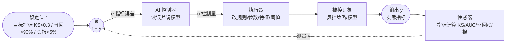
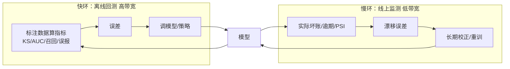

# 风控策略 / 模型建模：控制工程视角

> 风控策略与模型建模是控制工程**最理想**的落地场景——数值传感器（指标）、精确设定值（目标指标）、多目标优化（LQR）、明确收敛判据（指标达标）。
> 本文用控制工程框架解构风控/建模，并给出落地设计。

## 背景

风控策略/模型建模的核心活动是：建模型 → 跑指标 → 看是否达标 → 不达标调模型 → 再跑。这和反馈控制闭环同构，且因为指标是数值化、公式确定的，传感器信噪比极高——比业务闭环（靠人判断）稳得多，甚至比交易策略闭环（收益单一目标）更适合控制工程。

控制工程铁律在风控/建模里同样适用：**传感器质量 > 控制器智能，设定值明确 > 调参技巧，收敛判据明确 > 迭代次数**。

## 控制闭环结构



## 控制工程对应

| 控制工程 | 风控策略 / 模型建模 |
|---|---|
| 设定值 r | 目标指标（KS、AUC、召回、误报、坏账、PSI 的目标值）|
| 被控对象 P | 风控策略/模型（规则集/评分卡/ML 模型）|
| 传感器 | **指标计算**（标注数据/回测/线上，公式确定）|
| 输出 y | 实际指标值 |
| 误差 e=r−y | 目标指标 − 实际指标（数值可量化）|
| 控制器 C | AI/人（读误差 → 调模型）|
| 控制量 u | 改规则/模型参数/特征/阈值 |
| 前馈补偿 | 业务约束/合规（字段必用/禁用、阈值上下限、监管红线）|
| 自适应 | AI 按指标迭代调模型（控制器参数自演化）|
| LQR / 代价函数 | 多目标加权（召回 vs 误报 vs 坏账，权重权衡）|
| 收敛判据 | 指标达标（最明确，非"差不多"）|

## 双频反馈：风控特有的洞察

风控指标分两种频率，对应控制工程的快慢环分离：



| 反馈类型 | 频率 | 控制角色 | 对应控制工程 |
|---|---|---|---|
| 离线/回测指标（标注数据算 KS/AUC）| 快（分钟级）| **主反馈**，高带宽，快速收敛调模型 | 内环跟踪 |
| 线上指标（实际坏账/逾期/PSI）| 慢（月级）| **慢反馈**，长期校正模型漂移 | 外环校正（类似积分 I） |

离线指标快但不完全等于线上（分布偏移），所以用离线快速迭代收敛 + 线上慢反馈做长期校正——**快慢环分离**（内环快稳 + 外环慢精）。这是控制工程在风控最关键的应用：离线指标别当真理，线上指标别当唯一（太慢），两者配合。

## PID / LQR / MPC 的具体对应

**PID**：
- **P（比例）**：当前指标离目标的偏差 → 立即调（如 KS 差 0.05，调阈值）
- **I（积分）**：多轮迭代指标累积不达标 → 系统性调整（换特征/换模型类，不是微调）
- **D（微分）**：指标变化趋势 → **检测过拟合**（训练集指标涨但验证集降 = 过冲，该停/正则化）

**LQR（多目标优化）**：召回、误报、坏账互相制约，加权代价函数：
```
J = w1·(召回 − 目标)² + w2·(误报 − 目标)² + w3·(坏账 − 目标)²
```
权重 w 体现业务偏好（高召回优先还是低误报优先）——和 LQR 的 Q 矩阵加权同构。调权重 = 调业务偏好。

**MPC（模型预测）**：AI 预测"改这个特征/参数后指标会怎样"再调。但预测不可靠（模型行为复杂），需离线指标兜底纠错——预测负责"快"，传感器负责"准"。

## 落地设计

与交易策略闭环同构，复用 Aether 的知识对象 + tool 编排架构：

### 1. 模型/策略存知识对象（定义优先）

- `kind=模型` / `kind=规则` / `kind=特征`
- body 写：模型定义（特征列表/参数/阈值）、训练约定、评估口径
- typed links：`uses→特征集`、`applies-to→数据源`、`validated-by→评估指标定义`

### 2. 指标计算 tool（传感器）

类似交易的 `RunBacktest`：
- `EvaluateModel(modelName, dataset)` → 跑标注数据算 KS/AUC/召回/误报/坏账
- 返回结构化指标（数值）——这是确定性精确的反馈传感器

### 3. 调模型 tool（控制量）

类似 `UpdateKnowledgeObject`：
- `UpdateModel(modelName, features?/params?/thresholds?)` → 改模型定义
- 改完触发重评估 → 指标更新 → 误差反馈

### 4. 闭环

```
AI 建模型（CreateKnowledgeObject kind=模型）
  → 跑指标（EvaluateModel 传感器，返回 KS/召回/误报）
  → 看误差（目标 vs 实际）
  → 不达标 → 调模型（UpdateModel 控制量）
  → 再跑指标 → ... 直到达标
  → 上线 → 线上指标（慢环）监测漂移 → 重训
```

## 注意事项（控制工程警示）

1. **过拟合 = 过冲**：训练集指标涨但验证集降，控制系统在过冲。需 D（微分）检测趋势 + 早停（收敛判据：验证集指标不增则停）。
2. **分布偏移 = 扰动**：线上分布和训练不同，模型漂移。PSI（群体稳定性指数）= 残差监测，超阈值触发重训（外环校正）。
3. **样本不平衡 = 传感器偏差**：坏账样本少，指标噪声大（坏账率 1% 时少量样本波动大）。需置信区间/更大样本——传感器不确定时降增益（别过度调）。
4. **多目标冲突 = 耦合系统**：召回和误报 inherently 权衡，不能两个都拉满。LQR 加权明确权衡，别试图"全都要"（那是控制不可达）。
5. **A/B 测试 = 参考模型自适应（MRAC）**：新模型 vs 现网模型对照，新模型优于参考才上线——控制工程的参考模型自适应控制。
6. **收敛判据要含验证集**：只看训练集指标 = 传感器只测开环，会过拟合。必须验证集/时间外样本指标作收敛判据。

## 与其它场景对比

| | 业务闭环 | 交易策略闭环 | 风控/建模闭环 |
|---|---|---|---|
| 传感器 | 人判断（模糊）| 回测收益（数值，单一）| **指标（数值，多维）** |
| 设定值 | 模糊（"对不对"）| 模糊（"赚钱"）| **精确（KS>0.3）** |
| 多目标 | 少 | 单一（收益/回撤）| **多（召回/误报/坏账）→ LQR** |
| 收敛判据 | 人定 | 收益满意 | **指标达标（最明确）** |
| 漂移监测 | — | — | **PSI（外环）** |
| 控制工程纯度 | 低 | 中 | **高** |

风控/建模是三者里控制工程纯度最高的——数值传感器 + 精确设定值 + 多目标优化 + 明确收敛判据 + 漂移监测。如果把这套架构落地，风控/建模是最能证明"控制工程思维 + AI agent"价值的场景。

## 一句话

风控策略/建模 = **数值传感器（指标）驱动的自适应反馈控制**，设定值精确（目标指标）、传感器确定（公式算）、多目标可加权（LQR）、收敛判据明确（达标）。用离线指标快环收敛 + 线上指标慢环校正，控制工程的快慢分离在此最典型。落地复用知识对象 + 指标计算 tool + 调模型 tool，AI agent 就能在"建模型→跑指标→调模型"的闭环里自动迭代到指标达标。

---

> 参见 CLAUDE.md「Knowledge objects」节（知识对象闭环与控制工程同构，三者结构对应）、[docs/ai-coding-control.md](ai-coding-control.md)（AI 编程扩展的控制工程路线图 + 交易策略落地实例）。
