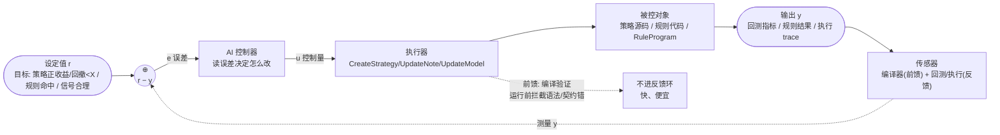
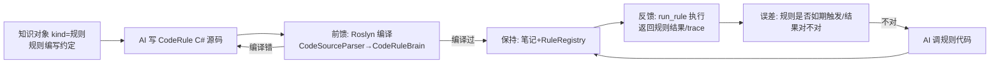
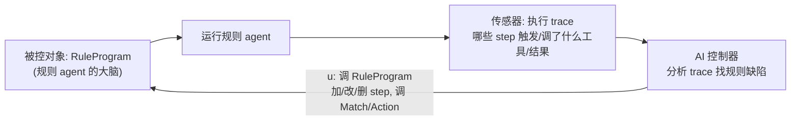
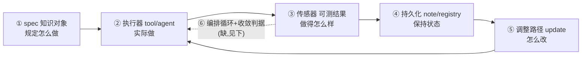

# 自进化闭环：控制工程视角下让现有功能"自己变好"

> Aether 已经零散地具备了一个控制系统的全部元件——传感器（编译器/回测/规则执行）、执行器（tool）、控制器参数（知识对象/源码）、被控对象（策略/规则/agent）。缺的不是零件，是**把它们接成闭环并让循环自动转起来**。
> 本文用控制工程框架解构"自进化"，并落到 Aether 当前已有的三个场景（策略编写 / 代码规则 / 规则大脑），给出从半自动到全自动还差什么。

## 核心论点：自进化 = 闭环控制

一个系统"自进化"当且仅当它构成闭环——设定值、传感器、误差、控制器、执行器、被控对象六要素齐备，且反馈通路闭合。缺任何一环都不是自进化：

- 缺传感器 = **盲调**（改了不测，靠信心）
- 缺执行器 = **空想**（知道该改但改不了）
- 缺反馈通路 = **开环**（写一次就定型，不迭代）
- 缺设定值 = **无目标**（不知道收敛到哪）

控制工程铁律在此同样适用：**传感器质量 > 控制器智能，前馈 > 反馈，小步长 > 大跨越，可观测 > 可控**。Aether 的独特优势是它站在**确定性传感器**之上（编译器/回测/规则执行都是公式确定的），信噪比高 → 闭环带宽高 → 收敛快且稳。这是它能做"自动自进化"的根本前提——业务闭环（靠人判断）做不到全自动，恰恰因为传感器是模糊的。

## 控制闭环结构



**两级传感器（快慢环分离）**——这是控制工程在自进化里最关键的设计：

| 反馈类型 | 角色 | 频率 | 对应 |
|---|---|---|---|
| 编译验证（Roslyn） | **前馈**，运行前拦截 | 毫秒级 | 内环快稳：语法/契约错不进运行环 |
| 信号探针（run_strategy） | **轻量反馈**，不起 Lean | 秒级 | 中环：信号合理性快速校验 |
| 回测（Lean）/规则执行 | **主反馈**，完整运行 | 秒~分钟级 | 外环：真实表现/行为 |

前馈强 → 反馈负载小 → 闭环更稳。能前馈拦截的（编译错）绝不留给反馈（跑完才发现）。这正是控制工程快慢环分离的体现。

## Aether 现有控制元件库（已有，不需新建）

| 控制元件 | Aether 中的实现 | 角色 |
|---|---|---|
| **传感器（前馈）** | `StrategyScriptCompiler`（Roslyn 即时编译）、`CodeSourceParser`+Roslyn（CodeRule） | 编译期确定性反馈，挡语法/契约错 |
| **传感器（反馈）** | `BacktestTool`（Lean 回测：收益/回撤/信号）、`RunStrategyTool`（信号探针，轻量）、`run_rule`（规则执行结果） | 运行期确定性反馈 |
| **执行器** | `CreateStrategyTool`/`CreateYamlStrategyTool`、`NoteTool.UpdateNote`、`KnowledgeTool.UpdateKnowledgeObject`、`RuleTool` | 改被控对象（写/改源码、改 spec） |
| **控制器参数（可调）** | 知识对象 `kind=规则`（编写约定）、策略源码、`RuleProgram` | 控制器读/调的参数集 |
| **被控对象** | 策略（`IStrategy` 实现）、CodeRule（`CodeRuleBrain`）、规则 agent（`RuleProgramBrain`） | 被 iterate 的对象 |
| **保持机制** | 笔记持久化（note）+ `StrategyRegistry`/`RuleRegistry` 运行时注册 + `NotesChanged` 自动重编译 | 控制器记忆，跨会话不归零 |
| **控制器** | AI agent（读误差 → 决定 u） | 决策核心 |
| **循环驱动（缺）** | `AutomationScheduler` + `IAgentExecutor`（business-port）已有调度骨架，但未接自进化循环 | 把人驱动的轮次变成自动轮次 |

## 场景一：策略编写自进化闭环（元件已齐备，最接近可转）

这是控制工程纯度最高的场景——双传感器（编译器+回测）+ 明确设定值（收益/回撤）+ 可调源码。完整闭环：

```mermaid
graph TB
    SPEC["规定怎么写<br/>知识对象 kind=规则<br/>IStrategy 契约 + 参数规范"] --> AI1
    AI1["AI 写策略<br/>CreateStrategyTool"] --> COMPILE["前馈传感器<br/>Roslyn 即时编译"]
    COMPILE -->|编译错| AI1
    COMPILE |"编译过"| PERSIST["保持<br/>存 CodeStrategy 笔记<br/>NotesChanged→自动重编译注册"]
    PERSIST --> RUN["反馈传感器<br/>run_strategy 信号探针 / RunBacktest 回测"]
    RUN --> EVAL["误差 e<br/>指标 vs 目标"]
    EVAL -->|不达标| AI2["AI 调策略源码<br/>NoteTool.UpdateNote"]
    AI2 --> PERSIST
    EVAL -->|达标| DONE(["收敛: 上线/入库"])
    PERSIST -.->|"防发散: 连续N次变差→回退版本"| ROLL["回退到上一稳定版"]
```

**五步对应**（你问的"规定→写→保持→失败→运行"）：

1. **规定怎么写**：一个知识对象 `kind=规则`，body 写策略编写约定（必须实现 `IStrategy`、`WarmUpBars`/`EvaluateSignal` 契约、`ParameterDefinitions` 声明参数、命名规范、常见坑）。AI 先 `ReadKnowledgeObject` 拿规范再写。改约定一处，所有策略下次读拿新版（复用）。
2. **AI 实际写**：`CreateStrategyTool`（C# 策略）或 `CreateYamlStrategyTool`（声明式 YAML）创建策略笔记 + **即时编译验证**（前馈传感器，`Compiled`/`CompileError` 反馈）。
3. **怎么保持**：笔记持久化 + `StrategyScriptingService` 订阅 `NotesChanged`（500ms 防抖）→ 自动 Roslyn 重编译 → `StrategyRegistry.Register`。**不重启即生效**，且跨会话不丢（控制器记忆）。
4. **失败了怎么办**：分层失败处理（见下节）。
5. **运行策略**：`RunStrategyTool`（信号探针，轻量快速看信号合理性）→ 满意再 `RunBacktest`（Lean 全量回测看收益/回撤）。误差 = 目标指标 − 实际指标 → AI 调源码 → 重编译 → 再测，直到达标。

**已具备**：全部传感器、执行器、保持机制。**缺**：自动转起来的编排循环 + 收敛判据 + 防发散回退（见"从半自动到全自动"）。

## 场景二：代码规则引擎闭环

结构与策略闭环同构，传感器换成"编译 + 规则执行"：



- **规定**：知识对象写规则约定（CodeRule 的方法签名、`IRuleBrain` 契约、如何读 history/调工具）。
- **写**：AI 写 C# 源码笔记（`NoteNodeType.CodeRule`）→ `CodeSourceParser` → Roslyn 编译成 `CodeRuleBrain`（无 LLM 的代码大脑）。
- **保持**：笔记 + `RuleRegistry`。
- **运行**：`run_rule(name, input)` 执行规则 → 返回结果。**反馈传感器 = 规则执行结果 + trace**（哪些分支触发、调了什么工具）。
- **误差**：规则没如期触发 / 结果不符预期 → AI 调代码 → 重编译 → 再 run。

与策略场景的差异：规则的"达标"不总是数值化的（可能靠人判断规则对不对），所以**全自动门槛更高**——若规则结果能转成数值指标（命中率/误报率）就能全自动，否则停在人审核那步。

## 场景三：规则大脑自进化（meta——控制器调控制器）

这是最有意思的场景：被控对象本身是一个规则控制器（`RuleProgram`），AI 在更高一层观察它、调它。



- **被控对象**：一个规则 agent 的 `RuleProgram`（YAML：steps/noMatchReply/maxSteps）。
- **传感器**：规则 agent 的执行 trace——哪些 step 触发了、调了什么工具、tool 结果、是否走到 NoMatchReply。这是**行为级反馈**，比策略的收益指标更模糊，但比业务闭环的"人感觉"精确。
- **控制器**：AI 读 trace → 判断规则哪里不对（该触发的没触发？不该触发的触发了？action 的 args 错了？）→ 改 RuleProgram（加 step / 调 Match 的 regex / 改 Action 的 Tool/ReplyText）。
- **保持**：规则笔记（`NoteNodeType.Rule`）+ `RuleRegistry`，改完自动重载。

这是"控制器调控制器"的自适应控制——AI 调的不是业务逻辑，而是另一个控制器的参数。理论上可以套娃（再上一层观察 AI 调得好不好），但实践上两层够用。

## 通用模式：业务自进化闭环模板

抽象出任何业务做自进化需要的六要素，满足就能套闭环：



| 要素 | 作用 | Aether 已有 |
|---|---|---|
| ① spec | 设定值 + 规定做法 | ✅ 知识对象 |
| ② 执行器 | 实际执行 | ✅ tool/agent |
| ③ 传感器 | 可测量的结果 | ⚠️ 数值化场景有（策略/规则），业务场景缺 |
| ④ 持久化 | 控制器记忆，跨会话不归零 | ✅ note + registry |
| ⑤ 调整路径 | 改 spec/源码 | ✅ UpdateNote/UpdateKnowledgeObject |
| ⑥ 编排+收敛 | 自动转 + 知道何时停 | ❌ **缺，这是最后一环** |

**判断一个业务能否自进化的关键**：它的结果能不能**数值化**。能数值化（策略收益、规则命中率、模型 KS）→ 能全自动；不能（"这个方案好不好"）→ 只能半自动（人当传感器）。这是控制工程"传感器质量决定上限"的直接推论。

## 你问的两个点：保持 & 失败了怎么办

### 怎么保持（控制器记忆）

保持不是单纯存文件，是让闭环**跨会话不归零**：

- **spec 保持**：知识对象存编写约定，所有迭代轮次都 read 同一份，改一处全局生效。
- **产物保持**：策略/规则源码存笔记，`StrategyRegistry`/`RuleRegistry` 持运行时句柄，`NotesChanged` 自动重编译——改完不重启即生效。
- **进度保持**：每轮的 metric 记进 trace/对话历史（`IConversationStore`），重启后能看历次误差曲线（阶跃响应），判断是在收敛还是震荡。
- **版本保持**：每次改前留版本（笔记历史 / git），震荡时能回退到上一稳定点。这是防发散的物资基础。

### 失败了怎么办（分层失败处理）

不同失败层级有不同反馈带宽和 remedy，别一锅烩：

| 失败层级 | 信号源 | 带宽 | remedy |
|---|---|---|---|
| **编译失败**（前馈层） | Roslyn CompileError | 毫秒 | AI 读错误改语法/契约，**不进运行环** |
| **运行失败**（执行层） | 回测/执行抛异常 | 秒 | AI 诊断（数据缺失？逻辑错？边界？） |
| **指标不达标**（反馈层） | metric < 目标 | 秒~分钟 | AI 调逻辑/参数，进入下一轮迭代 |
| **指标发散**（防发散） | 连续 N 轮 metric 变差 | 多轮 | **停 + 回退**到上一稳定版 + 上报人（抗积分饱和） |

关键纪律：**防震荡/发散判据必须有**。AI 闭环没有解析极点判稳，但"误差趋势"是经验判据——连续 N 次误差不降就停（不是死磕），连续 M 次误差增大就停（系统在发散，继续是负作用）。没有这个判据，闭环可能极限环（反复改两个版本来回跳）或发散（越改越差）。

## 从半自动到全自动：缺的最后一环

当前 Aether 的闭环是**半自动**的——人 chat 驱动每一轮（AI 写 → 人看结果 → 人让 AI 改）。人是环里的控制器。要全自动，把"看结果→决定改→改"编码成自动循环。需要四样东西：

1. **编排器**：自动 run → evaluate → decide → rewrite → re-run。Aether 已有骨架：`AutomationScheduler`（1min 轮询 Timer）+ `IAgentExecutor`（business-port，host 侧 `ConversationBackedAgentExecutor` 实现接 `ICustomAgentRunner`）。一个自进化循环 = 一个 AutomationTask，fire 时跑一轮迭代，结果 thread 进专属 conversation。**调度器已能驱动，缺的是"单次 fire 跑完整迭代循环而非单轮对话"的语义**。
2. **机器可判的收敛判据**：metric 达标是数值化可判的（收益 > 0 / 回撤 < X / 命中率 > Y）。这是全自动的前提——判据不能机器判定就只能停在人审核。把判据写进 AutomationTask 的 prompt 或一个判定 tool。
3. **防发散 + 回退**：记历次 metric，连续变差时自动 stop + 回退。需要一个"版本游标"（笔记历史或 git tag）+ 判定逻辑。
4. **可观测**：每轮 metric 记成误差曲线（阶跃响应），人能看是否在收敛。复用 `TraceViewModel`（OTel trace 页）或记进 conversation 让人翻。

**全自动的边界**：数值传感器场景（策略/规则/模型）能全自动到"达标即停"；模糊传感器场景（业务方案）只能自动到"跑完等人判"。别强求模糊场景全自动——那是控制不可达。

## 控制工程警示

1. **过拟合 = 过冲**：策略在回测数据上越调越好但样本外变差 = 控制系统过冲。需验证集/时间外样本作收敛判据，只看训练数据 = 传感器只测开环。
2. **小步快改**：每轮只改策略的一两个参数/一段逻辑，立刻测。大改 = 大步长 = 过冲（破坏原本对的、引新错）。
3. **前馈优先**：编译能挡的错别留给回测。两级传感器，前馈快环 + 反馈慢环。
4. **防震荡/发散必须有**：误差不降或增大就停 + 回退，不是死磕。AI 闭环没有解析判稳，靠误差趋势。
5. **分层控制**：外环（策略整体思路/架构）错，内环（参数调）再稳也白费。外环错回外环，别在内环死磕。
6. **可观测先于可控**：先让每轮 metric 可见（误差曲线），再谈自动控制。黑盒闭环出问题无法诊断。

## 一句话

Aether 已有控制系统的全部零件（传感器=编译器/回测、执行器=tool、参数=知识对象/源码、保持=note+registry），把它们接成闭环就是自进化；策略编写/代码规则/规则大脑三个场景里，前两者元件已齐备、只差"编排循环+收敛判据+防发散"这最后一环就能从半自动转全自动——而全自动的前提是结果能数值化（策略收益能、业务方案不能），这正是控制工程"传感器质量决定上限"的实证。

---

> 参见 CLAUDE.md「Knowledge objects」「Rule agent」「Trading + Lean」节——本文引用的全部控制元件（CreateStrategyTool/StrategyScriptCompiler/RunStrategyTool/BacktestTool/CodeRuleBrain/RuleProgramBrain/run_rule/AutomationScheduler/IAgentExecutor/KnowledgeObjectDefinition）的真实实现位置与契约。
